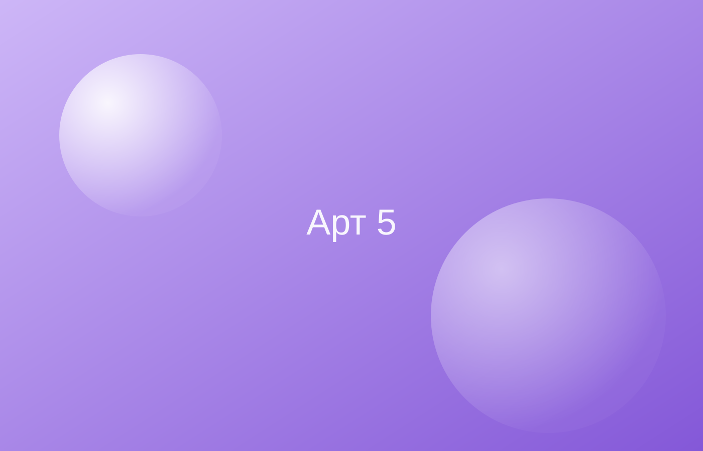

**Багряное Новолуние** — ученик врачевателя. Текст-заглушка: краткое описание персонажа в духе вики. *Курсив* и **жирный** работают как в обычной разметке, а [ссылки](https://example.com) выглядят вот так. Этот абзац сделан подлиннее, чтобы было видно, как текст обтекает портрет справа и как выравнивается по ширине.

Второй абзац краткого описания-заглушки: ещё немного текста про то, кем персонаж был и чем запомнился, чтобы рядом с портретом не оставалось пустого места.

## Характер

Текст-заглушка про характер персонажа. Достаточно длинное предложение, чтобы строка точно переносилась и было видно выравнивание по ширине вместе с красной строкой.

Второй абзац-заглушка, чтобы было видно отступы между абзацами.

### Сильные стороны

- Заглушка один
- Заглушка два

### Слабые стороны

Текст-заглушка про слабые стороны.

## Внешность

Текст-заглушка про внешность персонажа.

### Окрас

Текст-заглушка.

### Приметы

Текст-заглушка.

## Отношения

{{relations}}

## Биография

### Детство

Текст-заглушка про детство.

### Ученичество

Текст-заглушка про ученичество.

> Заглушка: цитата внутри текста.

## Интересные факты

- Заглушка: факт один
- Заглушка: факт два
- Заглушка: факт три
